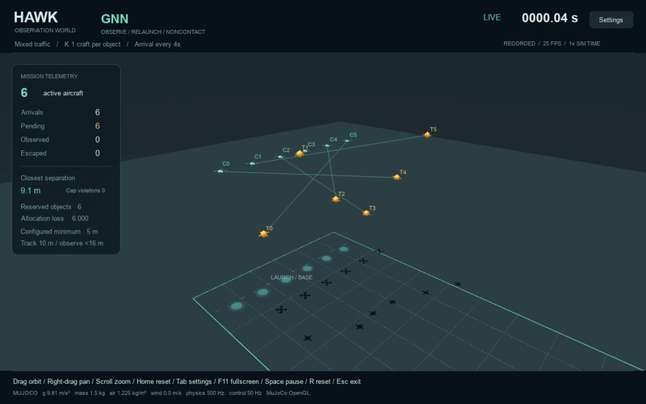
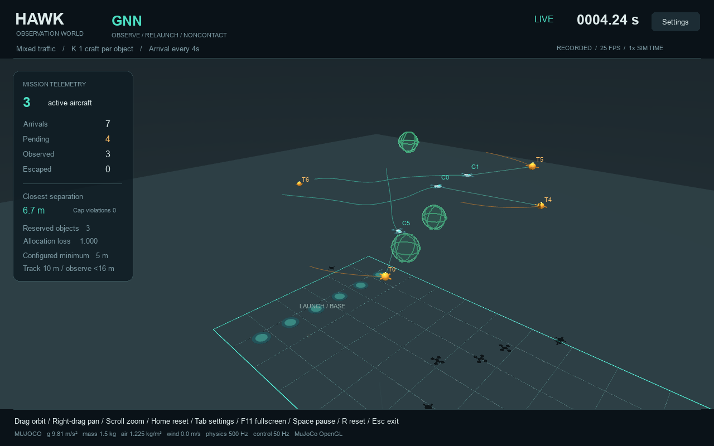
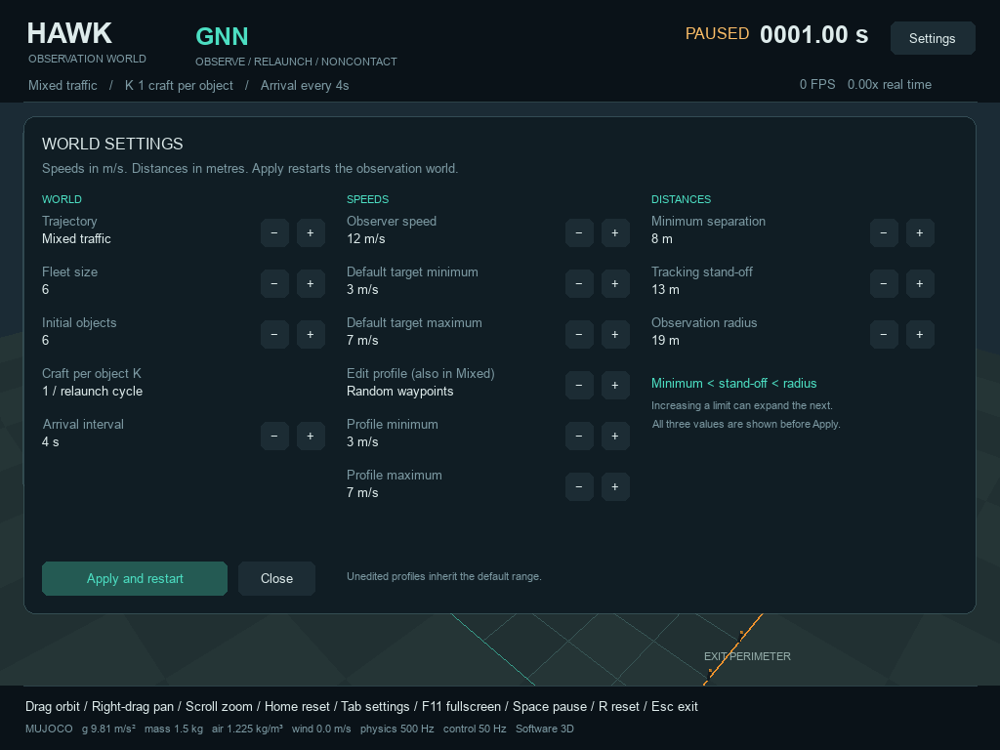

# HAWK — Python Drone Swarm Simulator with MuJoCo and PyTorch GNN

HAWK is a **3D drone swarm simulator in Python** for multi-agent target tracking
and task allocation. It combines **MuJoCo physics**, a **PyTorch graph neural
network (GNN)**, and an interactive **Pygame** view to compare learned allocation
with Greedy and Auction policies.

Watch autonomous observers follow moving aerial objects at a safe distance,
share the work, and launch replacements from a base. Configure flight paths,
speeds, separation distances, and continuous arrivals, or run seeded benchmarks
without a display.



*An actual seed-7 GNN run at normal simulation speed. Green bubbles mark
completed non-contact observation; replacement observers launch from the base.*

[Watch or download the 20-second video](docs/media/hawk-observation-demo.mp4)
· [Full-resolution tracking view](docs/media/hawk-tracking.png)
· [Capture details](docs/media/capture-provenance.json)

The demo uses MuJoCo OpenGL rendering at 1280 × 800 and 25 FPS, with no audio.
The animated preview shows its first 12 seconds.

## What you can study

- **Multi-agent task allocation:** compare Greedy, mesh Auction, and GNN
  preferences under a shared one-observer-per-object reservation rule.
- **Drone target tracking:** explore safe-distance observation of random,
  constant-height, weaving, parabolic, and orbiting aerial paths.
- **Robotics simulation and guidance:** inspect proportional navigation,
  thrust limits, actuator lag, gravity, drag, and wind in a 3D physics world.
- **Graph neural networks for swarm robotics:** train a small message-passing
  policy on simulated local sensor tracks and measure coverage and inference cost.

[Installation](#installation-and-quick-start) ·
[Configuration](#configuration-reference) ·
[Allocation benchmarks](#greedy-auction-and-gnn-task-allocation-benchmarks) ·
[Physics and GNN training](#mujoco-physics-sensor-tracks-and-pytorch-gnn-training) ·
[Measured results](#recorded-results)

## Installation and quick start

Use **Python 3.11 or newer**:

```bash
git clone https://github.com/Rajneesh100/hawk-swarm-simulator.git
cd hawk-swarm-simulator
python3 -m venv .venv
source .venv/bin/activate
python -m pip install -r requirements.txt
python main.py
```

The trained checkpoint is included at `output/swarm_gnn_model.pt`, so training
is optional. The default launch opens a **fullscreen, continuous GNN world**:
six observers, six initial objects, mixed trajectories, and a new object every
four simulated seconds. Press **Tab** for settings or **Esc** to quit. Use
`python main.py --windowed` for a resizable window.

Dependencies are NumPy, PyTorch, Pygame, and MuJoCo. A GPU is not required.
MuJoCo provides the physics in both graphics modes; native OpenGL rendering is
preferred, with a software perspective view when a graphics context is unavailable.

## What happens in the world

1. Objects move through a metre-scaled arena along configurable aerial paths.
2. Each observer receives noisy local position and velocity estimates, then its
   policy proposes an object to track.
3. A reservation service allows **at most one observer per object** in the default
   mode. Unassigned observers hold position; excess objects remain unassigned
   and continue flying toward the perimeter.
4. The same reserved observer must remain **at least 5 m away and within 16 m**
   for **two continuous seconds**. It aims for a 10 m stand-off distance.
5. Successful observation removes the pair and plays a green bubble animation.
   A replacement observer launches from its base pad after at least 1.5 seconds,
   once the pad is clear. The first fleet starts airborne.

An object that reaches the exit perimeter before completion is recorded as
escaped. **Contact does not count as successful observation.** Safe distance is
a configurable operating constraint; finite thrust, sensing, and avoidance mean
the simulation measures violations rather than assuming they cannot happen.



*Three completed pairs have left the scene. The remaining observers keep
tracking while replacements wait to launch from clear base pads.*

## Change the experiment

Open **Tab → Settings** to change the fleet, arrivals, trajectory, speeds, and
distances. **Apply and restart** starts a new seeded world with those values.
The profile speed editor works independently of the selected world trajectory,
so you can tune individual profiles while running Mixed mode.



*The settings panel keeps minimum separation, tracking stand-off, and observation
radius ordered. This software-rendered example stages an 8 m / 13 m / 19 m band.*

### Speeds and safe distance

```bash
# Observer reference speed: 14 m/s; independent object speed bands
python main.py --chaser-speed 14 --trajectory mixed \
  --profile-speed weave 4 5 --profile-speed constant-height 6 6

# Minimum separation: 8 m; derive a compatible stand-off and outer radius
python main.py --safe-distance 8

# Set all three distances explicitly, in metres
python main.py --safe-distance 8 --stand-off-distance 13 --observation-radius 20

# Constant-height traffic with a different arrival rate and object speed band
python main.py --trajectory constant-height --target-speed-min 4 \
  --target-speed-max 6 --arrival-interval 3
```

Distances must satisfy `minimum < stand-off < observation radius`; minimum
separation must also exceed the physical body diameter (0.7 m by default).
Omitted stand-off and radius values become `max(10, minimum + 5)` and
`max(16, stand-off + 6)` metres. `--min-separation` is an alias for
`--safe-distance`.

Speeds must be positive, with minimum no greater than maximum. Repeat
`--profile-speed PROFILE MIN MAX` for any of the five actual profiles; profiles
without an override inherit the default object speed band. `--chaser-speed`
limits the guidance velocity reference, not the force-integrated physical state.

### Trajectories

| `--trajectory` | Motion |
|---|---|
| `random` | Smoothly changing waypoints, lateral maneuvers, and seeded drift |
| `constant-height` | Straight forward flight at the spawn altitude |
| `weave` | Forward flight with sinusoidal lateral motion |
| `parabolic` | Controlled altitude arc that stays above ground |
| `orbit` | Drifting horizontal orbit followed by outbound flight |
| `mixed` | Cycle through the five profiles as objects arrive |

These are controlled aerial paths, with bounded turning and altitude. The
default speed band is 3–7 m/s and altitude band is 20–60 m.

### Configuration reference

| Option | Default | Meaning |
|---|---|---|
| `--mode` | `gnn` | Live policy: `greedy`, `auction`, or `gnn` |
| `--chasers`, `--targets` | `6`, `6` | Fleet size and initial object count |
| `--arrival-interval` | `4` s | Time between arrivals in continuous mode |
| `--max-tracks` | `24` | Bounded physical object pool; full-pool arrivals count as dropped |
| `--trajectory` | `mixed` | Object motion profile |
| `--target-speed-min`, `--target-speed-max` | `3`, `7` m/s | Fallback object speed band |
| `--profile-speed PROFILE MIN MAX` | No overrides | Per-profile object speed band; repeatable |
| `--chaser-speed` | `12` m/s | Observer cruise and guidance speed limit |
| `--safe-distance` | `5` m | Minimum separation, avoidance, and launch-clearance setting |
| `--stand-off-distance`, `--observation-radius` | Derived; normally `10`, `16` m | Preferred and outer tracking distances |
| `--relaunch-delay` | `1.5` s | Minimum wait before a replacement launches from a clear pad |
| `--altitude-min`, `--altitude-max` | `20`, `60` m | Object altitude band |
| `--wind X Y Z` | `0 0 0` m/s | World-frame wind vector |
| `--mass`, `--gravity` | `1.5` kg, `9.81` m/s² | Observer mass and gravity magnitude |
| `--sensor-range`, `--broadcast-range` | `150`, `150` m | Local sensing and peer connectivity |
| `--seed` | `7` | Reproducible scenario seed |
| `--model PATH` | `output/swarm_gnn_model.pt` | GNN checkpoint |
| `--duration` | Until quit live; `35` s headless/benchmark | Simulation-time limit |
| `--speed` | `1` | Visual playback multiplier; does not change physics timesteps |

For persistent-fleet experiments, `--keep-observers` keeps craft active after
service and permits a larger reservation cap:

```bash
python main.py --keep-observers --chasers 12 --targets 6 --chasers-per-object 2
```

The cap is a maximum, not a guarantee of that many available observers. The
default remove-and-relaunch cycle requires a cap of one. `--chasers-per-target`
is an alias for `--chasers-per-object`.

## Mouse and keyboard

| Control | Action |
|---|---|
| Left drag | Orbit the camera |
| Scroll wheel | Zoom |
| Right drag or Shift + left drag | Pan |
| Home | Reset camera |
| F11 | Toggle fullscreen |
| Tab | Open or close settings |
| Space | Pause or resume |
| R / Esc | Restart / exit |
| L / V / C | Toggle labels / trails / commitment lines |
| 1 / 2 / 3 | Restart the live world with Greedy / Auction / GNN |
| T | Cycle trajectory and restart the live world |
| `[` / `]` | Decrease / increase arrival interval and restart |
| `+` / `−` | Change capacity with `--keep-observers`; the relaunch cycle stays at one |

HUD and benchmark text remain fixed on screen while the camera moves. Pausing
also freezes the completion and launch animations.

## Greedy, Auction, and GNN task allocation benchmarks

```bash
# Visual comparison: identical seeded initial conditions, no new arrivals
python main.py --benchmark

# Save the three-policy headless benchmark
python main.py --headless --benchmark --seed 7 --json output/my-benchmark.json

# Continuous GNN with arrivals for 120 simulated seconds
python main.py --headless --duration 120 --json output/my-continuous-run.json

# Timed visual run with a final screenshot and effective configuration
python main.py --duration 20 --auto-exit --screenshot output/my-world.png \
  --json output/my-visual-run.json
```

`--modes greedy auction` selects a subset and implies `--benchmark`.
`coordinated` remains a compatibility alias for `auction`. Headless mode never
opens a window; screenshots require visual mode. JSON includes effective
configuration, service counts, capacity/separation violations, classified
contacts, message counts, and policy timing.

| Policy | How it proposes assignments |
|---|---|
| Greedy | Select the nearest locally eligible object |
| Auction | Exchange capability bids through the simulated mesh over multiple rounds |
| GNN | Run a trained, two-layer graph policy on local noisy observations in one forward call per due allocation cycle |

**All three use the same explicit reservation service.** This shared service
retains valid commitments and resolves competing proposals, enforcing capacity
even when the peer graph is disconnected. The GNN does not guarantee unique
assignments by itself, and the complete system is not fully decentralized.
Greedy therefore does not deliberately dogpile in the current comparison.

## MuJoCo physics, sensor tracks, and PyTorch GNN training

The software-in-the-loop boundary is small: a controller consumes a copied
local `Observation` and emits its own 3D acceleration request. It never receives
the simulation object. Mission reservations travel through a separate interface.

Control runs at **50 Hz**, while MuJoCo integrates at **500 Hz**. Coordinates
are metres, velocities are m/s, and acceleration is m/s². The 100 × 60 m arena
has ground at `z = 0` and an exit perimeter at `x = 100 m`.

The translational craft model includes gravity, 1.5 kg mass, force-limited thrust
(45 N), a first-order actuator response (0.08 s), wind, quadratic drag, and
contacts:

```math
m\dot{\mathbf v} = \mathbf F_{thrust} + m\mathbf g
- \tfrac12\rho C_d A\|\mathbf v-\mathbf w\|(\mathbf v-\mathbf w)
+ \mathbf F_{contact}, \qquad \dot{\mathbf p}=\mathbf v.
```

Ideal world-axis thrust and angular damping abstract stabilization; attitude
control and rotor mixing are not modeled. Aerial objects follow prescribed
kinematic paths. This is a research simulation, not a calibrated aircraft model.

Sensor payloads resemble local EKF tracks: relative 3D position and velocity,
closing speed, time to the observation band, zero-effort miss, and estimated
reachability. The tracker is simulated and omnidirectional; no camera driver,
occlusion model, real EKF, or aircraft connection is included.

The GNN uses ten normalized pair features
`[r_x, r_y, r_z, v_rel_x, v_rel_y, v_rel_z, V_c, t_go, ZEM, P_reach]`.
Edges join sensed peers within broadcast range. Two 32-wide EdgeConv layers
produce assignment logits; the bundled model has **17,505 parameters**.
Three-dimensional proportional navigation assists acquisition, with velocity
following, stand-off regulation, and predictive separation control.

Training uses Adam on randomized sensor snapshots and minimizes service leakage:

```math
X=\mathrm{Softmax}(W,\mathrm{targets}),\qquad
L=\sum_j\prod_i\left(1-X_{ij}P_{reach}(i,j)\right).
```

Here, `X` is the per-observer assignment probability and `P_reach` is estimated
reachability. The loss sums each object's probability of remaining unobserved.

```bash
# Optional: train a replacement checkpoint and write its report
python train_gnn.py --epochs 300 --seed 7

# Run the complete regression suite
python -m unittest discover -v
```

Training defaults to batches of 32, 128 held-out snapshots, and a 0.001 learning
rate. It writes `output/swarm_gnn_model.pt` and `output/gnn-training.json`; use
`--output` and `--json` to retain the bundled files. This is snapshot training,
not closed-loop reinforcement learning. Missing or incompatible weights fail
explicitly. Run `python main.py --help` or `python train_gnn.py --help` for options.

## Project layout

```text
main.py                    CLI, SITL runner, peer transport, and comparisons
sim_engine.py              Track motion, local observations, arrivals, and lifecycle
physics_constants.py       SI constants and trajectory names
physics_world.py           MuJoCo plant, force integration, and contacts
estimator.py               Relative kinematics and reachability
swarm_controller.py        Local policies and stand-off guidance
reservations.py            Shared capacity-limited reservation service
gnn_model.py               Graph encoder, two-layer policy, loss, and checkpoints
train_gnn.py               Randomized snapshot training and held-out evaluation
world_renderer.py          3D scene, mouse camera, Pygame HUD, and settings
test_*.py                  Physics, lifecycle, allocation, learning, and UI tests
requirements.txt           Python dependencies
docs/SPEC_AND_STATUS.md    Full equations, interfaces, assumptions, and evidence
docs/images/               Settings screenshot
docs/media/                Recorded demo, animated preview, stills, and provenance
output/swarm_gnn_model.pt  Ready-to-run trained model
output/*.json              Selected measured benchmark and training reports
```

## Recorded results

The latest recorded verification on **12 October 2026** passed **111 tests**.
The suite covers physics, trajectory bounds, safe observation dwell, removal
and base relaunch, identity reuse, reservation capacity, radio state resets,
neural inference/gradients, configurable distances/speeds, and renderer controls.

Default seed-7 benchmark, six observers and six initial objects, mixed profiles:

| Policy | Observed | Completion time | Minimum measured separation | Capacity violations |
|---|---:|---:|---:|---:|
| Greedy | 6/6 | 4.28 s | 6.714 m | 0 |
| Auction | 6/6 | 4.28 s | 6.749 m | 0 |
| GNN | 6/6 | 8.24 s | 6.697 m | 0 |

The **120-second continuous GNN run observed 35/35 objects**, removed 35 pairs,
and launched 34 replacements before the cutoff. It recorded no escaped or
dropped objects, capacity violations, below-minimum separation entries, or
body contacts. The custom-distance benchmark (6 m / 11 m / 17 m) also observed
6/6 in each mode. Ground-pad support contacts are counted separately from
craft/craft and craft/object contacts.

These are specific measured scenarios, not a guarantee for every configuration
or evidence that the GNN outperforms the classical policies. The GNN was slower
in the finite case above. The bundled checkpoint was not retrained for the
latest lifecycle or UI changes.

Evidence: [default comparison](output/benchmark-observer-cycle.json),
[continuous run](output/continuous-observer-cycle.json),
[custom speeds](output/configurable-speeds-cycle.json),
[custom distance](output/benchmark-safe-distance.json), and
[test log](output/test-results-publish.txt).

The recorded 20-second demo used offscreen MuJoCo OpenGL successfully: 10
arrivals, nine observations, nine replacements, and one object still pending
at the cutoff, with no escapes, capacity violations, or below-minimum separation
entries. The recording contains 500 frames played at 25 FPS; this is not a
real-time performance measurement.

Software rendering, settings, and fullscreen/input transitions were also checked
under SDL's dummy display driver. Native interactive macOS fullscreen still
needs validation in a desktop session. The display loop targets 60 FPS; actual
speed depends on backend and hardware, and the software renderer is not
guaranteed to reach 60 FPS.

See the [full specification and status](docs/SPEC_AND_STATUS.md) for equations,
interface contracts, exact validation records, and model limitations.
